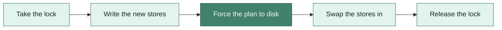

<!-- Link + badge definitions (maintained in one place) -->
[license]: LICENSE
[ci]: https://github.com/Auties00/Viridian/actions/workflows/ci.yml
[java26]: https://openjdk.org/projects/jdk/26/

[badge-ci]: https://img.shields.io/github/actions/workflow/status/Auties00/Viridian/ci.yml?branch=master&style=for-the-badge&label=CI&labelColor=0b0e14
[badge-java]: https://img.shields.io/badge/JAVA-26-f89820?style=for-the-badge&logo=openjdk&logoColor=white&labelColor=0b0e14
[badge-dependencies]: https://img.shields.io/badge/DEPENDENCIES-none-40826D?style=for-the-badge&labelColor=0b0e14
[badge-native]: https://img.shields.io/badge/NATIVE%20CODE-none-40826D?style=for-the-badge&labelColor=0b0e14
[badge-license]: https://img.shields.io/badge/LICENSE-MIT-40826D?style=for-the-badge&labelColor=0b0e14

<div align="center">

<br/>

# V I R I D I A N

### Read and write the storage of Chrome, Edge, Electron and WebView2 profiles in pure Java

<br/>

[![CI][badge-ci]][ci]
[![Java][badge-java]][java26]
[![License][badge-license]][license]

[![No dependencies][badge-dependencies]](#quick-start)
[![No native code][badge-native]](#quick-start)

</div>

Viridian reads what sites stored in a Chromium profile, and writes it back so precisely that the browser opens it as
its own.

## Quick start

```java
var profile = ChromiumProfile.open(Path.of(System.getenv("LOCALAPPDATA"), "Google", "Chrome", "User Data", "Default"));
var origin = StorageOrigin.parse("https://example.com");

// Read
try (var database = profile.indexedDb().open(origin, "app").orElseThrow();
     var records = database.records("settings")) {
    records.forEach(record -> System.out.println(record.key() + " = " + record.value()));
}
Map<String, String> items = profile.localStorage().items(origin);

// Write
profile.write(edit -> {
    edit.indexedDb().put(origin, IdbDatabase.builder("app", 1)
            .put(IdbObjectStore.of("settings"), IdbKey.of("theme"), JsValue.of("dark"))
            .build());
    edit.localStorage().replaceAll(origin, Map.of("session", "restored"));
});
```

Viridian needs Java 26 and is a single module, `com.github.auties00.viridian`, with no dependencies and no native
code: it brings its own LevelDB, SQLite, Snappy and zstd.

## What it covers

- **IndexedDB** and **`localStorage`**, read and written, on both of Chromium's backends: LevelDB and SQLite.
- **`sessionStorage`**, read. It belongs to the browsing sessions a browser restores, so writing it is left to the
  browser.
- **Storage buckets** opened with `navigator.storageBuckets`, and **partitioned storage** of a site embedded by
  another, read and written.
- **Every JavaScript value** IndexedDB can hold, Blink's platform objects included: `CryptoKey`s with their key
  material, `Blob`s, `File`s, `ImageData` and the rest.

## Opening a profile

A profile is the directory that holds a browser's or an app's site storage.

```java
var chrome = ChromiumUserData.open(Path.of(System.getenv("LOCALAPPDATA"), "Google", "Chrome", "User Data"));
System.out.println(chrome.profileNames());                     // [Default, Profile 1]
ChromiumProfile profile = chrome.profile("Default");

ChromiumProfile app = ChromiumProfile.open(Path.of(System.getenv("APPDATA"), "MyElectronApp"));
ChromiumProfile webView = ChromiumProfile.open(Path.of(System.getenv("LOCALAPPDATA"), "MyApp", "EBWebView", "Default"));
ChromiumProfile seeded = ChromiumProfile.create(Files.createTempDirectory("seed").resolve("Default"));
```

> [!TIP]
> Opening Chrome's `User Data` folder instead of a profile inside it is the classic mistake: `ChromiumProfile.open`
> refuses it and names the profiles it holds.

<details>
<summary><b>Where each kind of storage lives</b></summary>
<br>

- IndexedDB on LevelDB: `IndexedDB/<origin>.indexeddb.leveldb`, with large blobs in `<origin>.indexeddb.blob`.
- IndexedDB on SQLite: `IndexedDB/<origin>/`, one file per database.
- IndexedDB in any other bucket: `WebStorage/<id>/IndexedDB/`, on either backend.
- `localStorage`: `Local Storage/leveldb` on LevelDB, `LocalStorage` on SQLite.
- `sessionStorage`: `Session Storage` on LevelDB, `SessionStorage` on SQLite.

Every facade reads the backend Chromium reads: for IndexedDB, LevelDB whenever a bucket has a LevelDB store; for DOM
Storage, SQLite, which Chromium creates only where it uses it. An overload that takes a `StorageBackend` reads that
one only. Chrome began moving new IndexedDB databases to SQLite in Chrome 156, and is moving DOM Storage through field
trials.

</details>

## Reading

```java
var indexedDb = profile.indexedDb();

// Stream a store in key order, decoded as it goes
try (var database = indexedDb.open(origin, "mail").orElseThrow();
     var records = database.records("messages")) {
    long unread = records.filter(r -> r.value() instanceof JsObject m && m.getBoolean("unread").orElse(false)).count();
}

// Look a record up by key
try (var database = indexedDb.open(origin, "app").orElseThrow()) {
    Optional<JsValue> theme = database.get("settings", IdbKey.of("theme"));
}

// Or take the whole database as a value
IdbDatabase app = indexedDb.read(origin, "app").orElseThrow();

// localStorage and sessionStorage
Map<String, String> items = profile.localStorage().items(origin);
for (SessionStorageArea area : profile.sessionStorage().areas(origin)) {
    System.out.println(area.namespaceId() + ": " + area.items());
}
```

<details>
<summary><b>Reading a damaged store record by record</b></summary>
<br>

A cursor decodes a value only when asked, so a forensic tool can keep going past a damaged record and save its bytes:

```java
try (var database = indexedDb.open(origin, "mail").orElseThrow();
     var cursor = database.openCursor("messages")) {
    while (cursor.next()) {
        try {
            index(cursor.key(), cursor.value());
        } catch (ViridianException damaged) {
            Files.write(out.resolve(cursor.key() + ".bin"), cursor.serializedValue());
        }
    }
}
```

Values read as a page reads them: in a store whose keys are generated into a key path, Chromium stores a value
without its key and Blink adds it back on read, and so does Viridian, while `serializedValue()` keeps the bytes as
stored.

</details>

## Values

Every value is a `JsValue`, a sealed type: switch over it, or use the typed getters.

```java
if (app.records("users").get(IdbKey.of(42)) instanceof JsObject user) {
    String name = user.getString("name").orElse("?");
    long age = user.getLong("age").orElseThrow();
    byte[] avatar = user.getBytes("avatar").orElseThrow();           // an ArrayBuffer, a Uint8Array or any view
    JsCryptoKey key = user.get("key", JsCryptoKey.class).orElseThrow();

    switch (user.get("nickname").orElse(null)) {                      // tells {nickname: null} from no nickname
        case null -> System.out.println("no nickname");
        case JsNull _ -> System.out.println("nickname explicitly null");
        case JsString(var nickname) -> System.out.println(nickname);
        default -> throw new IllegalStateException("unexpected nickname");
    }
}
```

Building one is just as direct, and values are immutable once built:

```java
JsObject alice = JsObject.builder()
        .put("id", 1)
        .put("name", "Alice")
        .put("address", JsObject.builder().put("city", "Rome"))      // built together with alice
        .put("identityKey", JsArrayBufferView.uint8(publicKey))      // a Uint8Array
        .put("photo", JsBlob.of(Path.of("photo.png"), "image/png"))  // read when the value is written
        .build();

JsCryptoKey aes = JsCryptoKey.secret(SecretKeyAlgorithm.AES_GCM, raw32)
        .usages(JsCryptoKey.Usage.ENCRYPT, JsCryptoKey.Usage.DECRYPT)
        .build();
SecretKey forJava = aes.toSecretKey();
```

<details>
<summary><b>More about values</b></summary>
<br>

- **Typed getters** read `undefined`, `null` and a missing property as empty, throw `ClassCastException` naming the
  property and both types when it holds something else, and `getLong` throws `ArithmeticException` past 2^53.
- **Identity:** objects compare by identity, as in JavaScript, and a value the page stored twice decodes to one
  object, cycles included. `JsValue.deepEquals` compares two values by what they hold.
- **CryptoKeys** are made from their material plus only what the material does not say, as `importKey` takes them:
  the hash of an HMAC or RSA key, never a length, curve, modulus or exponent. `key.algorithm()` holds the full
  dictionary a page reads, and a key's material is there even when the page made it non-extractable.
- **Standalone values:** `StructuredClone.deserialize` decodes any value Chromium serialized, from IndexedDB or
  elsewhere, and `StructuredClone.serialize` writes one as Chrome would. It writes Blink's version 21 with V8's
  version 15, which Chrome reads since version 109; only a resizable buffer past 4 GiB needs V8 16, and Chrome 149.

</details>

## Writing

A database is a value, built with IndexedDB's own rules: in-line keys are read from the value, generated keys come
from the store's key generator, and a unique index refuses a second record, all at the `put` that breaks them.

```java
IdbObjectStore people = IdbObjectStore.builder("people").keyPath("id").index("byEmail", "email", IdbIndex.Option.UNIQUE).build();
IdbObjectStore notes = IdbObjectStore.builder("notes").keyPath("id").autoIncrement().build();

IdbDatabase database = IdbDatabase.builder("app", 3)
        .put(people, alice)                                           // key 1, from alice.id
        .put(notes, JsObject.builder().put("text", "hi").build())    // key generated, added as id
        .build();

profile.indexedDb().put(origin, database);                            // "app" added or replaced, others kept
profile.indexedDb().replaceAll(origin, List.of(database));            // the origin ends with "app" alone
target.indexedDb().copyFrom(source.indexedDb(), origin);              // every database, record by record
```

> [!NOTE]
> Viridian writes on the backend each origin already uses, LevelDB for a new one, and keeps `localStorage` equal on
> every backend the profile has, so whichever one Chrome reads holds the new data. It refuses to write values the
> profile's browser is too old to read, as `Last Version` or the profile's `Preferences` record it.

### One step, under the browser's lock

`profile.write(edit -> ...)` commits every store an edit touches at once:

```java
target.write(edit -> {
    for (var bucket : source.indexedDb().buckets()) {
        edit.indexedDb().copyFrom(source.indexedDb(), bucket);
    }
    for (var key : source.localStorage().storageKeys()) {
        edit.localStorage().copyFrom(source.localStorage(), key);
    }
});
```

The new stores are written beside the old ones and swapped in by a plan forced to disk first:



A crash before the plan leaves the old stores untouched; a crash after it is finished by the next write, so the
browser never sees a mix.

> [!IMPORTANT]
> Close the browser before writing. While Viridian writes it holds the browser's own lock on the profile, so a
> browser that starts meanwhile does not open the profile, and two writers, in one process or two, exclude each other.
> A profile in use is refused with a `ProfileInUseException`:
>
> ```java
> try {
>     profile.write(edit -> edit.localStorage().replaceAll(origin, items));
> } catch (ProfileInUseException inUse) {
>     System.err.println("Close the browser using " + profile.lockDirectory());
> }
> ```

## Storage keys and buckets

A page embedded by another site gets storage of its own, partitioned by the top-level site, and a page can open named
buckets with `navigator.storageBuckets`. A `StorageKey` names the first, a `StorageBucket` the second, and every
method also takes a plain `StorageOrigin` for an origin's own storage.

```java
var embedded = StorageKey.partitioned(origin, "https://news.example");   // origin, embedded in news.example
var drafts = new StorageBucket(StorageKey.of(origin), "drafts");

for (var bucket : profile.indexedDb().buckets()) {
    System.out.println(bucket + ": " + profile.indexedDb().names(bucket));
}
profile.indexedDb().put(drafts, database);
profile.localStorage().replaceAll(embedded, Map.of("embedded", "true"));
```

Chromium keeps every bucket except an origin's own default one under `WebStorage/<id>`, numbered by its quota
database. Viridian finds them there and registers the ones it creates.

## Errors

Everything that reads or writes throws an `IOException`. A `ViridianException` says the files were reached but their
contents could not be read, or may not be written, and its `reason()` says why:

-  the data is damaged, truncated, or not what it claims
  to be.
-  a format Viridian does not know, or a value newer
  than the browser that would read it.
-  something the data refers to is gone, such as a stored
  blob's file.
-  a browser, an app or another writer has the profile open;
  always a `ProfileInUseException`.

Damaged or hostile files make the readers throw, never loop or recurse without bound.

## Tested against real Chrome

Every push runs the test suite on Windows, macOS and Linux, checking the SQLite reader and writer against SQLite
itself, the codecs against their reference implementations, and the LevelDB reader and writer against iq80's LevelDB.
Then Chrome for Testing, stable and beta, runs a round trip on both backends. Chrome writes a profile holding every
kind of value, blob and key, a storage bucket and partitioned storage. Viridian reads it, and must match what the page
read back. Viridian copies it into a new profile in one write, and Chrome must read the copy exactly as it wrote the
original, and keep writing to it.

A last check starts Chrome while Viridian holds the lock, and runs Viridian against a running Chrome. The workflow
also runs weekly, to catch a Chrome release that changes a format.

## Good to know

> [!CAUTION]
> Viridian never decrypts what a browser keeps encrypted for its user, such as saved passwords and cookies.

- A LevelDB IndexedDB store is written whole, so putting one database rewrites the bucket's other databases too.
- Reading takes no lock: a profile a browser is writing reads as a best-effort view. Copy the profile, or close the
  browser, to read it consistently.
- An Electron app that does not ask for a single instance holds no profile lock; Viridian then refuses only the
  stores the app has open.

## Building

```shell
mvn verify
```

<details>
<summary><b>Running the Chrome tests locally</b></summary>
<br>

1. Run `npm install` in `ci/chrome` (Node.js), and get a Chrome: any executable works, and
   `npx @puppeteer/browsers install chrome@stable` installs the one CI uses.
2. Have Chrome write a profile: `node generate.mjs <chrome> <user data> <leveldb|sqlite> <manifest>`.
3. Read and copy it: `mvn test -Dtest=ChromeProfileTest,ChromeCopyTest` with `VIRIDIAN_CHROME_PROFILE` set to
   `<user data>/Default`, `VIRIDIAN_CHROME_MANIFEST` to `<manifest>` and `VIRIDIAN_COPY_USER_DATA` to a new directory.
4. Have Chrome read the copy: `node read.mjs <chrome> <copy> <leveldb|sqlite> <manifest>`.
5. Check the lock: `mvn test -Dtest=ChromeLockTest` with `VIRIDIAN_CHROME_EXECUTABLE` set to the Chrome executable.

</details>

## License

Viridian is released under the [MIT license](LICENSE).
